<p align="center">
  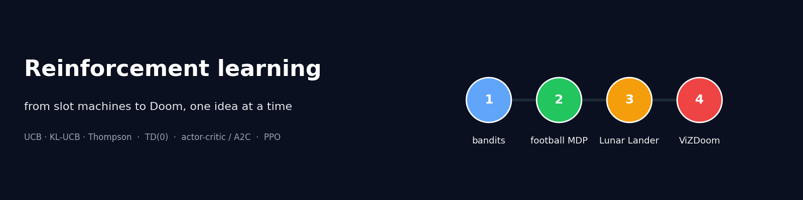
</p>

<p align="center">
  
  
  
  
  
  
</p>

> **TL;DR.** A four-stage reinforcement-learning project from summer 2025. Each stage adds one big idea:
> 1. **Multi-armed bandits:** ε-greedy, UCB, KL-UCB and Thompson sampling, written from scratch. *How do you explore without wasting too much reward?*
> 2. **A 2-vs-1 football game:** I designed the game as a Markov decision process and wrote the whole environment, three opponents and a TD(0) learner, with no starter code. *How does an agent learn the value of a situation from experience?*
> 3. **Lunar Lander:** a neural-network actor-critic in PyTorch. I first wrote it with hand-coded eligibility traces, then rebuilt it as a batched A2C with 16 parallel environments. It reached an average reward of 200 (the "solved" mark), and the **saved checkpoint is in this repo**.
> 4. **ViZDoom "defend the center":** PPO on raw pixels with my own reward shaping. Over 1 M steps, the agent learned to survive more than **3× longer**.

---

## The path through the project

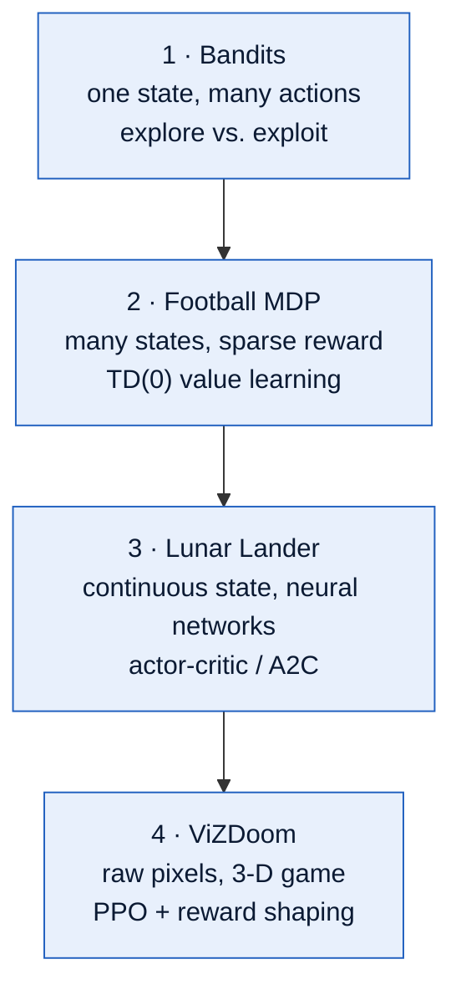

---

## 1 · Multi-armed bandits: exploring without wasting reward

A slot machine has four arms. Each pays out 1 with an unknown probability (0.23, 0.55, **0.76**, 0.44). The agent has a few thousand pulls, so every pull spent testing a worse arm costs reward. **Regret** counts that cost: the reward lost compared with always pulling the best arm.

I wrote four agents ([`01_multi_armed_bandits/`](01_multi_armed_bandits)), each on the same small interface (`give_pull`, `reinforce`):

| Agent | How it decides what to try | File |
|---|---|---|
| **ε-greedy** | pull the best-looking arm, but 1 % of the time pull a random one | [`epsilon_greedy.py`](01_multi_armed_bandits/epsilon_greedy.py) |
| **UCB** | add a confidence bonus √(2 ln t / n) to each estimate and pull the most *optimistic* arm | [`ucb.py`](01_multi_armed_bandits/ucb.py) |
| **KL-UCB** | the same optimism, with a tighter bound based on KL divergence, found by a search over q | [`klucb.py`](01_multi_armed_bandits/klucb.py) |
| **Thompson sampling** | keep a Beta belief per arm, draw one sample from each, and pull the highest draw | [`thompson.py`](01_multi_armed_bandits/thompson.py) |

**What the agents believe.** UCB's confidence bars shrink around the arms it pulls, and it stops pulling an arm once even its optimistic bound falls below the best one. Thompson's Beta curves sharpen into spikes at the true payout rates (dashed lines):

<p align="center">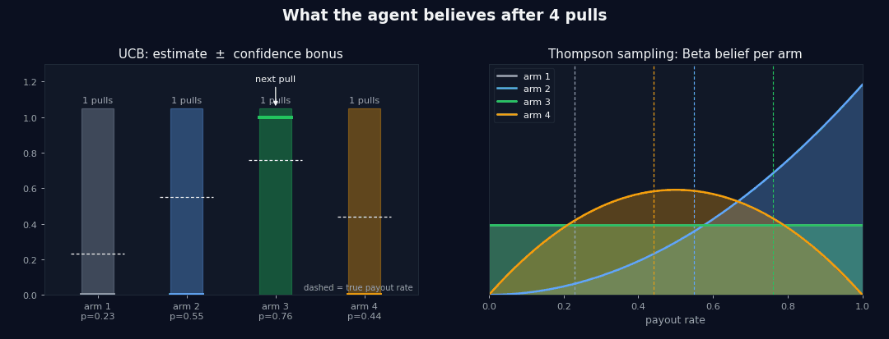</p>

**The race.** All four agents play the same bandit. The bars show how each one spreads its pulls, and the curves show regret averaged over 12 runs:

<p align="center">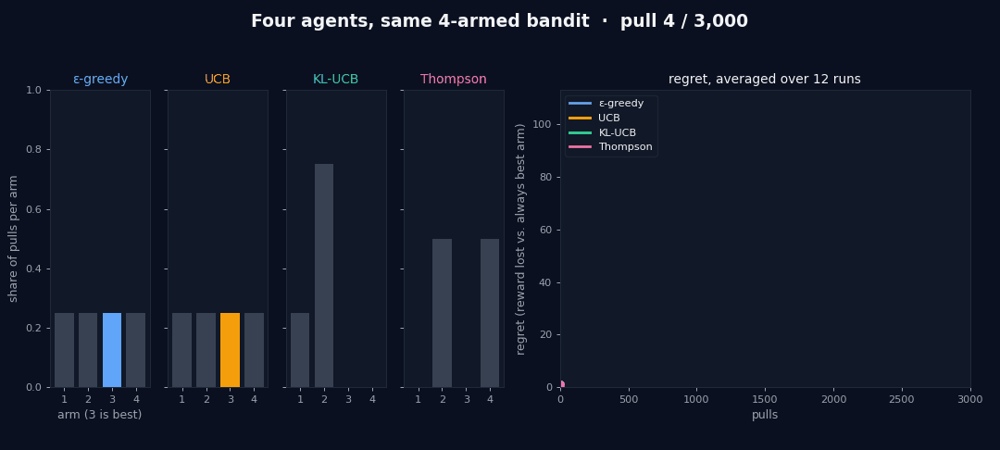</p>

After 3 000 pulls, **Thompson sampling loses the least** (about 18 rewards), followed by KL-UCB (39), ε-greedy (53) and UCB (105). UCB's bonus is deliberately cautious: it keeps re-checking arm 2, whose payout rate of 0.55 is fairly close to the best. ε-greedy settles quickly, but its 1 % random pulls make its regret keep growing forever. A second experiment ([`compare_agents.py`](01_multi_armed_bandits/compare_agents.py)) uses two arms with payout rates p and p + 0.1, for 17 values of p over 30 000 pulls. When the two arms are this close, KL-UCB and Thompson sampling adapt best. UCB's looser, Hoeffding-based bound makes it over-explore.

---

## 2 · Football: a 2-vs-1 game as a Markov decision process

Two attackers (**B1**, **B2**) try to score past one defender (**R**) on a 4 × 4 pitch. The brief came with **no starter code**, so I designed the state, actions and transitions, and wrote the environment, the opponents and the learner myself ([`02_football_2v1_td0/`](02_football_2v1_td0)).

<p align="center">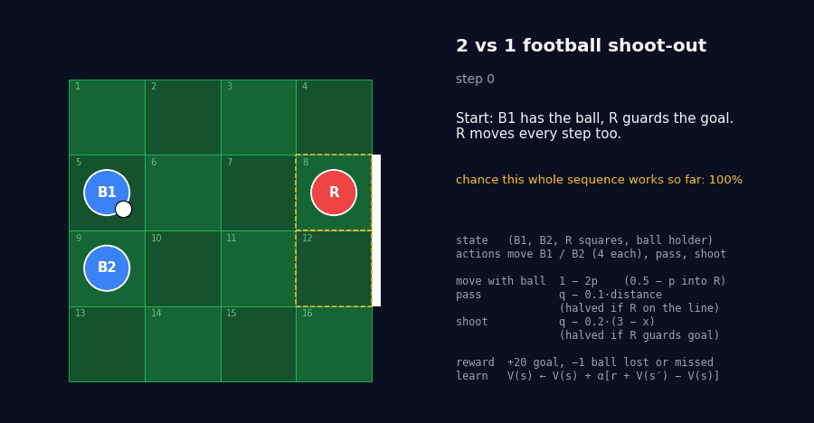</p>

- **State:** the squares of B1, B2 and R, plus who has the ball ([`definitions.py`](02_football_2v1_td0/definitions.py)).
- **Actions:** move B1 or B2 (4 directions each), pass, or shoot. Every action can fail:
  - dribbling keeps the ball with probability 1 − 2p, or only 0.5 − p when the player moves into R;
  - passes get less reliable with distance;
  - shots get more reliable closer to goal.
  - Passes and shots succeed only half as often when R is on the passing line or guarding the goal.
- **Reward:** +20 for a goal, −1 when the ball is lost, a shot misses or a player steps out of bounds.
- **Opponents** ([`opponent.py`](02_football_2v1_td0/opponent.py)): R can be *random*, *greedy* (it chases the ball) or *defensive* (it holds the zone in front of goal).
- I also added a rule the brief did not cover: if R lands on the ball carrier's square while the *other* attacker moves, the ball is lost.

**Learning.** I tried several methods before choosing **TD(0)** ([`algorithms/finalattempt.py`](02_football_2v1_td0/algorithms/finalattempt.py)). It learns the value V(s) of each situation from the update V(s) ← V(s) + α[r + V(s′) − V(s)]. To choose an action, the agent runs each of the 10 actions through the simulator 10–20 times and picks the one with the best average r + V(s′). Exploration (ε) starts at 0.75 and decays as exp(−episode / 150 000) over 275 000 episodes. Because a win is worth +20, the learned value of the start state converts directly into a **win probability**: (1 + V) / 21.

<p align="center">
  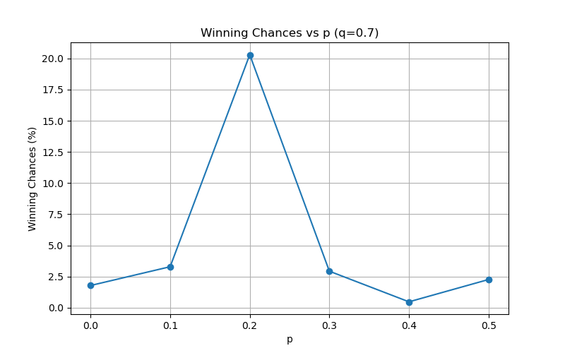
  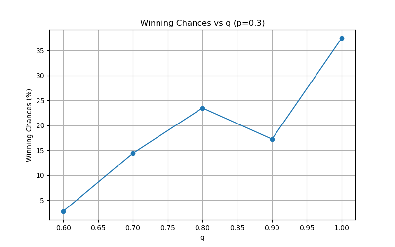
</p>

More accurate passing and shooting (higher q) lifts the win chance from about 3 % to 37 %. The curves are noisy, though. The episode count was tuned on a different start state, so some runs had not fully converged; the dip at q = 0.9 is one of them.

---

## 3 · Lunar Lander: actor-critic with neural networks

The lander has 8 continuous state variables and 4 actions (do nothing, fire left, main or right engine). An episode counts as **solved at a reward of 200 or more**. A tabular method can't work here, so both the policy (actor) and the value function (critic) are 128-128 MLPs in PyTorch.

<p align="center">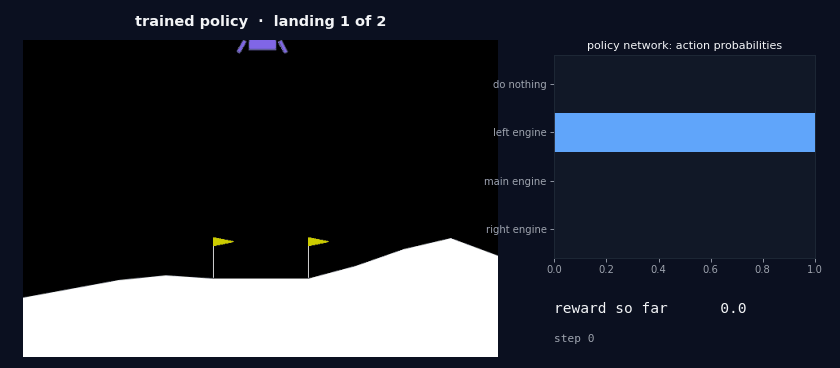</p>

<sub>The trained checkpoint in this repo, flying two fresh episodes. The bars on the right are the policy network's action probabilities at each moment.</sub>

I built it in two versions:

| | [`simple_AC.py`](03_lunar_lander_actor_critic/simple_AC.py) | [`optimized.py`](03_lunar_lander_actor_critic/optimized.py) |
|---|---|---|
| Algorithm | one-step actor-critic | batched advantage actor-critic (A2C) |
| Gradients | **by hand**: eligibility traces on every policy weight, scaled by the TD error | Adam, with gradient clipping at 0.5 |
| Data | 1 environment, update every step | **16 environments in parallel** (GPU), update every 32 steps |
| Advantage | TD error r + γV(s′) − V(s) | the same, computed for the whole batch |
| Outcome | learned, but too slow to finish | **solved**: 100-episode average ≥ 200 |

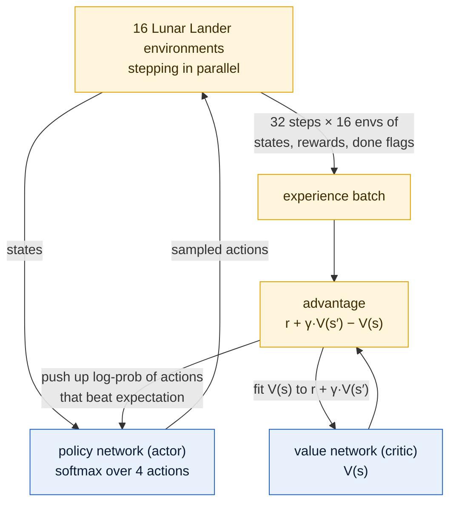

<p align="center">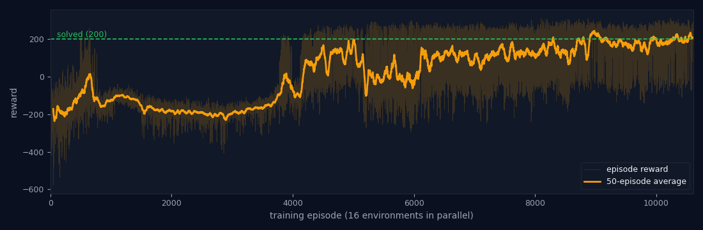</p>

The training curve above is read from the saved checkpoint: 10 613 episodes and 5.7 M environment steps, stopped once the last 500 episodes averaged 200. **On 100 new random starts, the greedy policy averages 176 and scores 200 or more in 70 % of them.** Policy-gradient learning shows its typical pattern: a long, flat stretch, then most of the progress arrives suddenly. The spread between episodes stays wide, so a better stopping rule would also look at the variance, not only the average.

---

## 4 · ViZDoom: learning from pixels

In *defend the center*, the player stands in the middle of a circular room while monsters close in from every side. The agent can only turn left, turn right or shoot, and it sees nothing but the screen. I wrapped ViZDoom as a Gymnasium environment ([`defend_centre.ipynb`](04_vizdoom_defend_the_center/defend_centre.ipynb)). Each frame is turned to greyscale and shrunk to a **100 × 160 image** before it reaches a convolutional PPO policy (Stable-Baselines3):

<p align="center">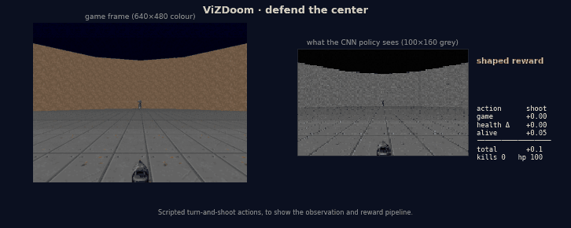</p>

<sub>This animation runs my environment wrapper with simple scripted turn-and-shoot actions, to show the observation and the reward. The trained weights were not kept.</sub>

**Reward shaping.** The game's own reward (+1 per kill, −1 on death) is very sparse, so I added three terms in `VizDoomEnv.step()`:

| Term | Value | Why |
|---|---|---|
| staying alive | +0.05 per step | survival is the actual goal of the scenario |
| health change | 0.05 × Δhealth | taking damage hurts right away, not only at death |
| firing | −0.1 per shot (optional; the final run set it to 0) | discourages wasting the limited ammo |

**Training:**
- PPO with a CNN policy, run on **4 environments in parallel**;
- 2048 steps per rollout, batch size 256, learning rate 1e-5;
- each action repeated for 3 frames;
- **1 M steps in 32 minutes**.

Compared with the sample solution, I gave training more steps, tuned the learning rate and batch size, and added the reward shaping. The mean episode length grew from about 120 to **410 steps**, so the agent now survives more than three times longer:

<p align="center">
  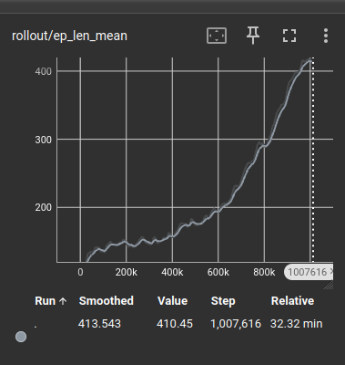
  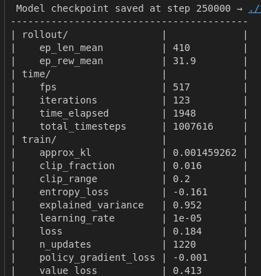
</p>

What I'd change next: log the kill count separately from the survival reward, because survival now dominates the total, and use a higher learning rate.

---

## Repository

```
01_multi_armed_bandits/        bandit environment, the four agents, and the experiment script
02_football_2v1_td0/           the football MDP, opponents, TD(0) learner, the brief (problem_description.html)
03_lunar_lander_actor_critic/  hand-written actor-critic, batched A2C, keyboard play, trained checkpoint
04_vizdoom_defend_the_center/  ViZDoom → Gymnasium wrapper and PPO training (notebooks)
docs/                          make_figures.py, which draws every animation above, and the figures
```

## Run it

```bash
pip install -r requirements.txt
```

```bash
cd 01_multi_armed_bandits && python compare_agents.py
```

```bash
cd 02_football_2v1_td0 && python main.py
```

```bash
cd 03_lunar_lander_actor_critic && python optimized.py
```

```bash
python docs/make_figures.py lander
```

The last command flies the saved Lunar Lander checkpoint and redraws its animation. For ViZDoom, open `04_vizdoom_defend_the_center/defend_centre.ipynb`.

## Credits

- **Bandit environment:** the environment and plotting helpers in `01_multi_armed_bandits/base.py` come from the course template (MIT licence, kept in that folder). The agents are my own.
- **Football:** the problem statement (`problem_description.html`) was provided as the brief. Everything else in that folder is my own.
- **Keyboard play:** `key_control.py` adapts Gymnasium's keyboard example for Lunar Lander.
